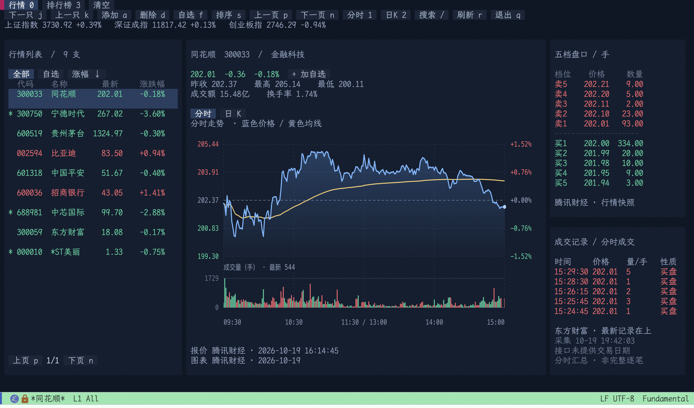

# THS

在 Emacs 中查看 A 股和场内基金行情、管理自选，以及浏览 A 股排行榜。基于 [ETAF](https://github.com/emacs-taf/etaf) 构建，支持鼠标操作和快捷键。



- 个股报价、三大指数与五档买卖盘。
- 分时图、日 K 和成交量副图；图形界面使用 SVG，终端使用字符图。
- 按名称或代码搜索股票、场内 ETF 和 LOF，添加、删除并保存自选。
- 按涨幅或成交额排序的 A 股排行榜，支持键盘选股和分页。
- 最近成交记录、定时刷新和数据源自动回退。

行情来自腾讯财经、东方财富和新浪财经的公开接口，无需 API Key。THS 提供行情展示，不包含交易功能。

## 安装

以下配置使用 Emacs 30.1+ 内置 `use-package` 的 `:vc` 功能。需要安装 Git 和 curl，并确保 Emacs 能访问 GitHub 及行情服务。

请先安装 [ETAF](https://github.com/emacs-taf/etaf) 0.2.1+ 及其依赖，然后将以下 THS 配置加入初始化文件：

```elisp
(use-package ths
  :ensure nil
  :vc (:url "https://github.com/guidao/emacs-ths.git"
       :lisp-dir "."
       :main-file "ths.el"
       :rev :newest)
  :commands ths
  :init
  (setq ths-refresh-interval 30
        ths-data-ranking-providers '(eastmoney sina)))
```

THS 本身要求 Emacs 29.1+，上面的安装方式要求支持 `:vc` 的 `use-package`。

执行 `M-x ths` 打开界面，行情会在后台加载。使用 `M-x package-vc-upgrade-all` 更新通过 VC 安装的包，更新后重启 Emacs。

## 使用

第一行切换行情页和排行榜，第二行是可点击的快捷按钮，例如“刷新 r”“搜索 /”。点击按钮与按对应快捷键执行相同操作。

| 按键 | 操作 |
| --- | --- |
| `j` / `k` | 下一只／上一只股票；排行榜中移动选中行 |
| `TAB` / `S-TAB` | 移动控件焦点 |
| `RET` | 激活控件；在排行榜中打开股票详情 |
| `a` | 搜索并添加自选股 |
| `d` | 删除当前自选股 |
| `f` | 切换当前股票的自选状态 |
| `/` | 按代码、名称或本地行业标签筛选行情列表；留空清除 |
| `s` | 行情列表切换涨幅排序；排行榜切换涨幅／成交额 |
| `1` / `2` | 分时图／日 K |
| `0` / `3` | 行情页／排行榜 |
| `n` / `p` | 下一页／上一页 |
| `r` | 刷新当前页面 |
| `T` | 切换亮色／暗色主题 |
| `g` | 重新适配窗口 |
| `q` | 退出当前窗口，保留会话和自动刷新 |

关闭 THS 缓冲区会停止定时刷新并取消请求。

默认使用暗色主题。按 `T` 或点击第二行的“主题 T”切换亮色，行情、排行榜、盘口及图表会一起更新，不影响当前选择和数据。窄窗口按钮显示为“主 T”。如需默认亮色，在配置中加入：

```elisp
(setq ths-theme 'light)
```

### 自选股

按 `a` 输入股票名称或部分代码，例如“茅台”“银行”“6005”。停顿后自动获取候选，按方向键选择、`RET` 添加。支持 Vertico，也可使用 Emacs 原生补全。

也可以直接输入六位股票代码，或带市场前缀的代码，例如 `sh600519`、`sz000001`、`bj920001`。在线搜索失败时仍可输入完整代码。

场内基金也通过 `a` 添加，例如 `510300`（沪市 ETF）、`159915`（深市 ETF）、`501018`（沪市 LOF）、`161725`（深市 LOF）。支持分时、日 K、成交量、五档盘口和最近成交记录；基金价格显示三位小数，接口缺失的数据显示为不可用。这里使用场内交易价格，不提供场外基金净值。

自选默认保存在 `user-emacs-directory` 下的 `ths-watchlist.json`，每次增删立即保存。删除自选不会从当前会话的“全部”列表中移除股票。

### 排行榜

按 `3` 打开排行榜，按 `s` 切换涨幅榜和成交额榜。排序由数据源服务端完成，与自选股和行情列表筛选无关。

表格按窗口宽度展示最新价、涨跌幅、成交量、成交额、流通市值、60 日涨跌幅和换手率。接口每页 20 支股票；窗口较矮时分段显示，`n` / `p` 和 `j` / `k` 可以连续翻页，无需滚动。

默认先请求东方财富，失败后尝试备用节点和新浪。异常空榜也会触发回退。页面显示实际数据源；新浪暂不提供 60 日涨跌幅，该列显示 `--`。

### 图表与布局

分时图和日 K 下方均显示成交量，与价格共用时间轴。日 K 使用不复权价格；分时图的黄色线为分钟价格的累计算术平均，不是成交量加权均价。

建议使用图形版 Emacs 并启用 SVG 支持。窗口达到 136 列时展示股票列表、图表和盘口三栏；较窄窗口默认显示个股详情。高度充足时，盘口下方显示最近成交记录。界面随窗口和文字缩放调整，最低需要 44 列、20 行。

## 配置

在 `use-package ths` 的 `:init` 中设置选项，例如：

```elisp
(setq ths-data-providers '(tencent eastmoney sina)
      ths-data-ranking-providers '(sina eastmoney)
      ths-data-symbols '("sh600519" "sz000001" "sz300750")
      ths-refresh-interval 30
      ths-data-timeout 10)
```

| 变量 | 默认值 | 说明 |
| --- | --- | --- |
| `ths-data-providers` | `(tencent eastmoney sina)` | 个股报价来源顺序；图表跳过新浪 |
| `ths-data-ranking-providers` | `(eastmoney sina)` | 排行榜来源顺序，独立于个股报价 |
| `ths-data-symbols` | 内置 8 支股票 | 初始行情列表，代码必须包含 `sh`、`sz` 或 `bj` 前缀 |
| `ths-refresh-interval` | `30` | 自动刷新间隔，单位秒，最短 5 秒；`nil` 关闭自动刷新 |
| `ths-data-timeout` | `10` | 每次 HTTP 请求的超时秒数 |
| `ths-auto-fetch` | `t` | 是否自动获取数据；`nil` 时仍可按 `r` 刷新 |
| `ths-data-curl-program` | `"curl"` | curl 命令名或绝对路径 |
| `ths-watchlist-file` | `user-emacs-directory` 下的 `ths-watchlist.json` | 自选保存位置；`nil` 表示仅保留在当前会话 |

更改来源顺序后按 `r` 生效。更改初始股票、自动刷新或自选文件设置后，关闭 THS 缓冲区并重新执行 `M-x ths`。

## 数据来源

| 数据 | 来源 | 说明 |
| --- | --- | --- |
| 个股、指数报价与五档盘口 | 腾讯、东方财富、新浪 | 按配置顺序回退 |
| 分时与日 K | 腾讯、东方财富 | 包含成交量；日 K 不复权 |
| 全市场排行 | 东方财富、新浪 | 按涨幅或成交额降序 |
| 最近成交记录 | 东方财富 | 最近最多 12 条快照，不累计完整成交历史 |
| 自选股搜索 | 东方财富 | 按名称或代码检索沪深京 A 股 |

价格和成交额统一为元，成交量统一为手（100 股），流通市值按万／亿元展示。缺失字段显示 `--`；请求失败时保留同一股票或榜单的上次成功数据并标记错误，不生成替代行情。

公开接口可能限流或变更。非交易时段可能返回上一交易日数据，“采集时间”表示接收数据的时间。成交记录属于分时成交快照，不是完整的 Level-2 逐笔流。

接口字段参考 [AKShare](https://github.com/akfamily/akshare) 和 [efinance](https://github.com/Micro-sheep/efinance) 的公开实现。

## 开发

确认 ETAF 及其依赖已安装，再检出 THS 源码：

```sh
git clone https://github.com/guidao/emacs-ths.git
cd emacs-ths
make check
```

以上源码检出用于开发和测试；日常安装使用前面的 `use-package :vc` 配置。

| 命令 | 作用 |
| --- | --- |
| `make check` | 严格字节编译和离线 ERT 测试 |
| `make run` | 从当前源码启动干净的 Emacs 并打开 THS |
| `make live-check` | 检查真实行情接口，需要网络；任一检查失败返回非零状态 |

仓库不附带依赖源码。Makefile 通过 `package-initialize` 加载用户已安装的依赖，不读取用户的初始化文件，也不自动安装依赖；THS 使用当前检出的源码。可通过 `EMACS` 指定 Emacs 可执行文件，通过 `LOAD` 覆盖加载参数。离线测试使用独立样本和临时自选文件，不读取或修改个人自选。

图形布局测试位于 [tests/ths-gui-tests.el](tests/ths-gui-tests.el)：在图形版 Emacs 中加载该文件，再执行 `M-x ert RET ths-gui-chart-geometry RET`。

主要模块：

| 文件 | 职责 |
| --- | --- |
| [ths.el](ths.el) | 界面、状态与交互 |
| [ths-data.el](ths-data.el) | 数据源、异步请求、解析与失败回退 |
| [ths-chart.el](ths-chart.el) | SVG 与字符图表 |
| [ths-watchlist.el](ths-watchlist.el) | 自选股持久化 |
| [ths-search.el](ths-search.el) | 异步搜索与补全 |

欢迎提交 Issue 和 Pull Request。报告问题时请附 Emacs 版本、图形／终端环境、复现步骤，以及页面显示的错误；界面问题可附截图和窗口尺寸。

## 许可证

[GPL-3.0-or-later](LICENSE)。
